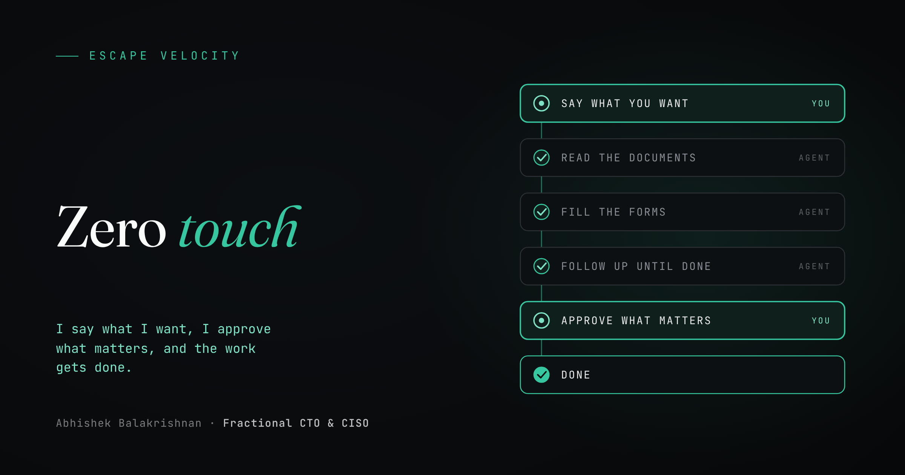

Last week I wrote about United banning AI agents from booking flights. A few people asked me what I actually want instead. My short answer is zero touch.

Zero touch means the outcome happens without me doing the manual steps. I say what I want, I approve what matters, and the work gets done. No forms, no hold music, no retyping information a company already has.

## We already know what it feels like

Some parts of life are already zero touch:

- Bills paid on autopay
- Paychecks landing by direct deposit
- A phone that backs itself up overnight
- A package that tracks itself to the door

Nobody misses writing checks or standing in line to deposit a paycheck. Once something becomes zero touch, going back feels absurd.

## Where we're still stuck

Plenty of everyday tasks still run on our time and patience:

- **Insurance claims:** take the photos, fill out the form, wait, then get a letter asking for the same information again.
- **Healthcare:** prior authorizations still bounce between doctors' offices and insurers, often by fax, while patients wait for care.
- **Government:** permits, renewals, and updating an address with five different agencies.
- **Returns and refunds:** a chatbot loop that ends with "please call us."
- **Bank disputes:** explaining the same charge to three different people.
- **Scheduling:** the back and forth of finding a time, which I live every single week.

In almost every case, the information already exists somewhere. The friction comes from hand-offs between systems that don't talk to each other, and the glue holding it together is usually the customer.

## Why it hasn't happened yet

From my years building software, I keep seeing three reasons:

1. **Incentives.** Sometimes friction is the business model. A claim that's hard to file is a claim that's less likely to get paid.
2. **Trust.** Companies can't tell whether a request really comes from you. That was United's stated worry.
3. **Plumbing.** A lot of critical systems are decades old and were never built to be connected.

## What changes now

AI agents can finally handle the messy middle: reading documents, filling forms, following up, and chasing a request until it's done. So the question shifts from "can software do this" to "will the system let it, and can we trust it."

That's a security and design problem, and it's solvable. Give agents a verified identity tied to the person they act for. Set clear permissions and spending limits. Require approval for anything that matters. Keep a record of every action. Banks went through this shift with open banking, and nobody wants to go back.

## Why it matters beyond convenience

This is about time and attention. Every hour on hold is an hour away from family, from building something, or for me, from practicing violin. It also matters for people who struggle most with today's systems: older relatives, people with disabilities, and anyone navigating forms in a second language. Zero touch levels the field for them first.

The companies that win the next decade will make themselves nearly invisible. I want to spend my attention on the things only I can do, and I think most people want the same. That's the human experience worth building toward.
