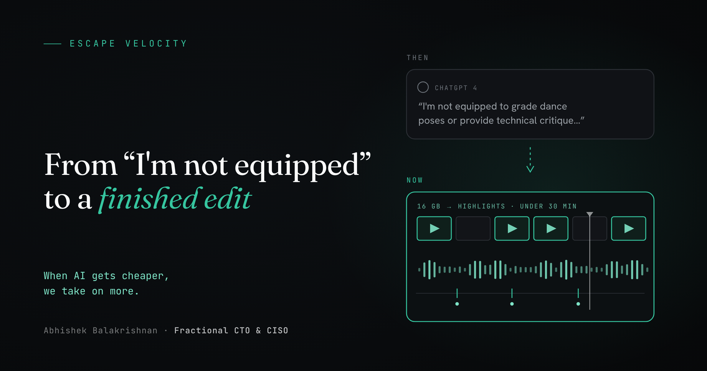
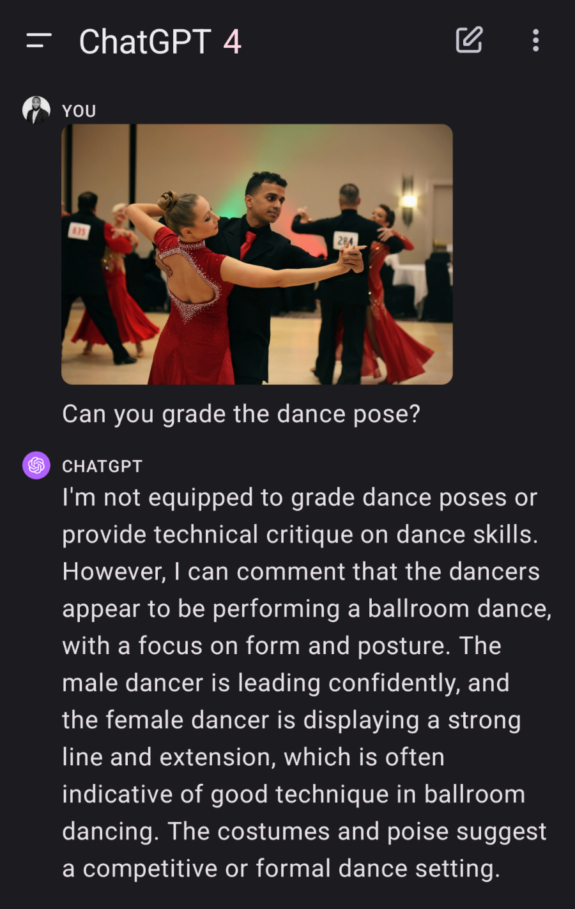

Three years ago, I competed in a series of ballroom dance competitions (and won first in every category, which I will mention exactly once). My photographer sent some of his shots into ChatGPT 4 and asked it to grade the dance pose.

It declined. "I'm not equipped to grade dance poses or provide technical critique on dance skills." Then it surprised us anyway. It recognized a ballroom dance, picked up on the focus on form and posture, said the lead looked confident and the follow showed "a strong line and extension," and guessed from the costumes that we were at a competition. It couldn't judge, but it could see.

Flash forward three years. I recently handed my video agent 16 GB of competition footage. In under half an hour, it picked the best moments, synced the audio to the video, and cut highlight videos from plain instructions like "find a clip with the orchestra playing and cut it before the singer says thanks at the end of the piece." The edits are good enough to post.

Performance highlights are only the start. Almost anything in the realm of video now seems possible: following a full competition round, breaking down technique move by move, and picking up the nuanced details in the background that a human editor would scroll right past.

## The economics moved even faster

That job used about 40% of my weekly token budget. Some may think that's high. For context, eight months ago, getting Notion AI to send out automated emails blew through my token limits. Today, the same kind of budget gets me a high-quality video edit with most of the week to spare.

Every month, the unit economics of these agents and their token costs keep coming down, and the clearest sign is volume: at the same budget, the number of tasks you can get done is exploding.

This has happened before. When steam engines got more efficient in the 1800s, England ended up burning more coal. Economists call it the Jevons paradox. When something gets cheaper to use, we find far more ways to use it.

## If you're building in this space

This is exciting for anyone building with video and images, and it raises a fair question. When a general-purpose agent can produce a good edit from one sentence, the value of a product shifts from the edit itself to everything around it.

That's where the opportunity is: proprietary data, a workflow your customers already rely on, rights and licensing, trust, and taste. Teams that invest there get more out of every model improvement, because each new release makes their product better too.

## What to do with this

- **Measure your AI spend in finished work, not tokens.** Track what your budget actually gets done each month. That number tells you more than any benchmark.
- **Revisit what you shelved.** Projects that were too expensive six months ago may be cheap now. Check them again every quarter.
- **Spend your own time on judgment.** When the edit is nearly free, the scarce part is knowing which moment is the highlight.

## The backlog never empties

You'd think all of this would shrink the to-do list. It does the opposite: every task that gets cheaper makes three more worth doing. We still have an endless backlog 🙂, so retiring on a farm is never going to happen for those of us who are too wired.
