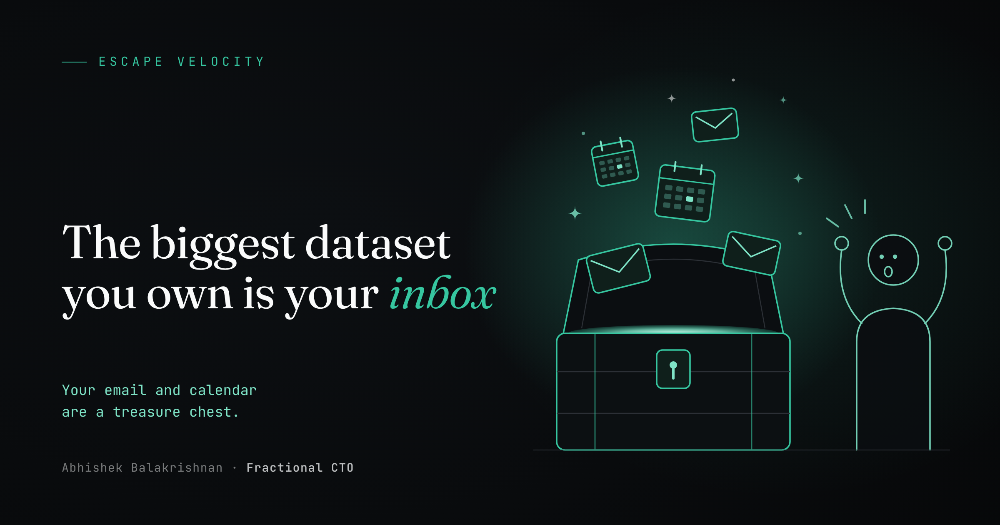

The biggest unstructured dataset most of us can mine today is sitting in our inbox and our calendar.

For years, search in both was limited. Meanwhile, both kept piling up mounds of data describing our most core routines and preferences: where we go, who we meet, what we buy, and how we spend our time.

Analyzing it was out of the question.

Last year, tools like Superhuman started adding AI to the inbox to make that history searchable. As of this summer, the general assistants have caught up. ChatGPT, Grok, and Claude can connect to your email and calendar and work through thousands of messages, or years of other unstructured history, in minutes.

## A small example

Here's one I tried myself. In seconds, Notion AI built a database of every tennis lesson I took in 2026, using nothing but booking confirmation emails. I could immediately see which instructor I trained with most, how many hours I put in this year, how many lessons were private versus group, how many I took per week, and what time of day I tended to play depending on the season.

None of it was hard to know in theory. I had just never added it up. As I wrote in [The AI Equation for Small Business](/blog/the-ai-equation-for-small-business/), what gets measured gets improved. Once you measure something, you get to second- and third-order insights quickly: from how much I trained, to which instructors and time slots I actually stick with, to how I should plan next season.

If you want to automate, strengthen a habit, or grow, a few small projects can turn your past decisions into better future ones. Each one ends in the same artifact: a short file that captures what your history says about you.

## Why a markdown file

A memory file is a plain text summary, usually a .md file, that an AI assistant reads before it helps you. My tennis database works the same way in a different format. Your raw data stays where it is. The file holds the distilled version: patterns, preferences, rules of thumb, and the handful of facts worth remembering. You can read it, edit it, and correct it. Load it into a Claude Project, a CLAUDE.md file, or the start of a chat, and the assistant starts from what you've already learned.

## Project 1: A travel agent that knows your history

If you travel often, your inbox holds a complete record of every travel decision you've made: every flight purchase, upgrade, and bag check, every time you used points instead of a card, every cancellation, delay, reroute, and rebooking. It knows which aircraft you flew and which ones had mechanical problems, when you had to gate-check a bag because the bins were full, when you fly most, which airlines you favor, and which years you earned status. The list goes on.

The facts are only half the value. Seeing them brings back the opinions you forgot you had. When the data shows you flew a cramped regional jet in January 2022, you remember exactly how that felt. When it shows you flew international on a Monday, passed on the business upgrade, and still had 30 empty seats around you, you remember that too, and you know it might be a good bet next time. Write those opinions into the file next to the facts, and your next booking starts from both.

```
Search my email from the last five years for airline, hotel, and travel booking
confirmations, receipts, upgrade offers, bag fees, gate-check notices, delay and
cancellation notices, rebookings, and loyalty statements. Cross-check trip dates
against my calendar.

Build a table with one row per flight: date, day of week, route, airline,
aircraft type, fare paid, cash or points, cabin, upgrade offered or taken, bags,
and any disruption (mechanical delay, cancellation, reroute, rebooking,
gate-checked bag).

Then write travel-profile.md with:
- When and how often I travel, by month and year
- The airlines, routes, and aircraft I fly most, and when I earned or lost status
- What I typically pay per route and season, and when points beat cash for me
- Disruptions by airline, route, and aircraft type
- My preferences, written as rules

Finally, list the 10 trips that stand out most and ask me what I remember about
each, so I can add my own notes.

Do not include confirmation codes, card numbers, passport or loyalty numbers,
or addresses.
```

Next time you book, start with: "Read travel-profile.md. Is this fare good for me, and should I use points?"

## Project 2: What your calendar says about your week

Your calendar is a record of everything you said yes to, and most of us never total it up. A weekly 30-minute sync costs 26 hours a year. A quick intro call turns into a monthly meeting. A focus block gets overwritten every Thursday for six months. Ask for the specifics:

```
Review my calendar for the last 12 months.

1. Total meeting hours per week, and how that changed by quarter.
2. My top 10 recurring meetings by total hours this year, when each started,
   and whether its length or attendees have changed.
3. One-off meetings that turned into recurring ones.
4. Focus or blocked time that got overwritten by meetings, and on which days.
5. My longest back-to-back stretches without a break.
6. The days and times I'm most and least booked.
7. Travel days and time zone changes, and what my meeting load looked like
   around them.

Write calendar-profile.md with these numbers, the three recurring meetings most
worth cutting or shortening, and the weekly schedule my calendar suggests I
work best in.
```

Read it before you accept your next recurring meeting.

## Project 3: Where you actually went

Your inbox and calendar record what you planned. Google Maps Timeline records where you actually went. If you've had it turned on, it holds years of commutes, trips, and every place you visited, along with how long you stayed.

It can answer questions most people never could: how many hours a week you really spend commuting, how that changed when you moved or went remote, how many new places you visited this year compared with five years ago, and how far from home a typical week takes you.

Google now keeps Timeline on your phone, so export it from the Google Maps app's settings. It comes out as a JSON file, which an assistant with file access, like Claude Code, can analyze on your own computer.

```
Analyze my Google Maps Timeline export. Do not output exact coordinates or
addresses, and refer to my home and workplace only as "home" and "work."

Calculate:
1. Weekly commute hours by year and by mode (driving, transit, walking).
2. Distinct places visited per month and per year, and how many were new to me.
3. Time spent by type of place: gyms, parks, restaurants, offices, airports.
4. My typical weekly travel radius from home, and how it changed over time.
5. My most consistent routines, like the same place on the same day each week.

Write places-profile.md with the trends and three observations I might act on.
```

## Keeping the files fresh

Each file is a living document. Once a month, run a shorter version of the prompt on only the new data, and ask the assistant to update the file and list what changed. Read the changes. You're the editor. When the assistant gets something wrong, fix the file, and the correction sticks.

## A word on tradeoffs

None of this is required. Optimization is optional, and every project here trades a little privacy for better decisions. But for most of us, this data already lives online, with our email provider and with Google. The question is whether you put it to work.

If you had the foresight to set up alias or proxy emails five or ten years ago, for shopping, travel, and newsletters, your main inbox holds far less sensitive material, and this exercise is much simpler. If you didn't, do some housekeeping first. If you're concerned about an AI reading certain things, delete or move them out before you start: tax documents, medical records, bank statements, and anything under an NDA.

Then a few basics:

- Grant read-only access, and turn it off when you're done.
- Keep identifiers like account numbers, passport details, and your home address out of the memory files, and store the files somewhere private.
- Analyze location data on your own computer if you can, and keep only the summary.

Email itself is one of the biggest attack surfaces most of us have, and it deserves its own post. That one is coming next.

## Where to start

Pick the project closest to a decision you make often. If you fly every month, start with travel. Your past decisions are already written down. Put them to work.
